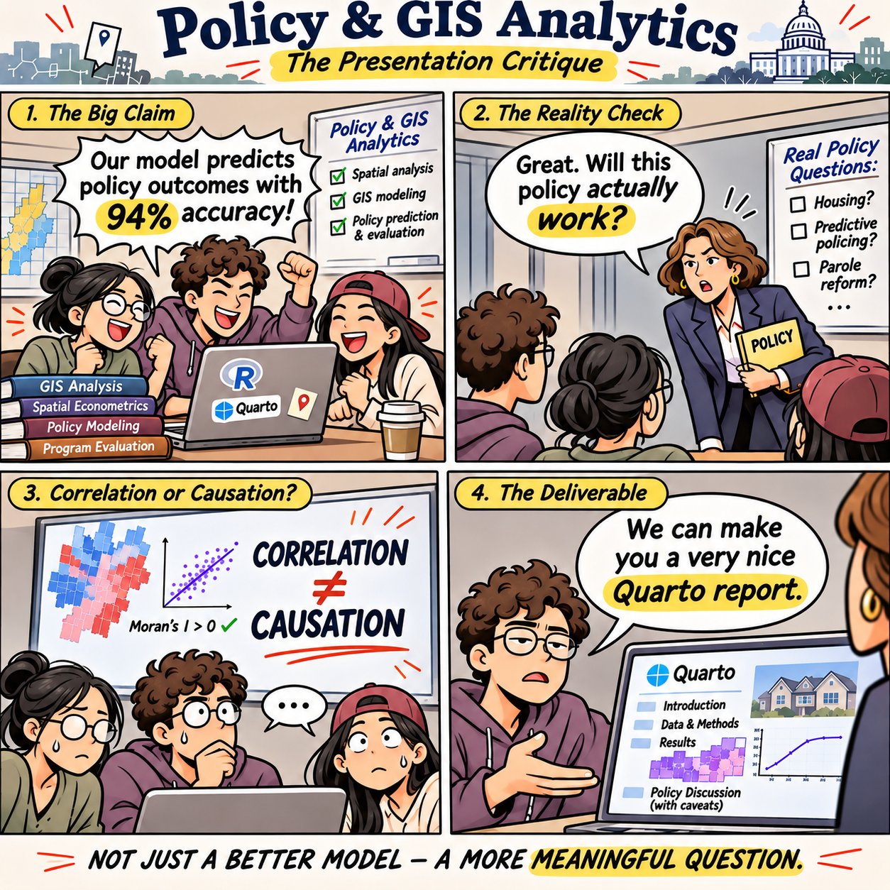
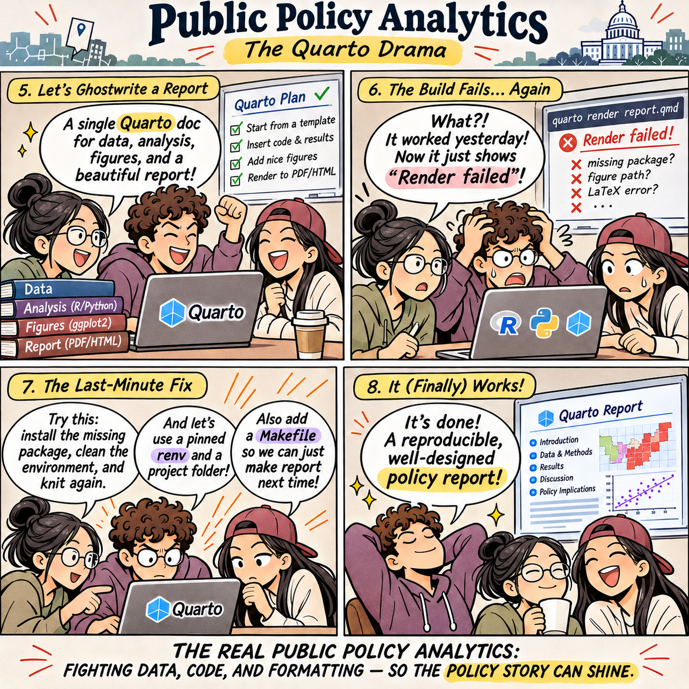
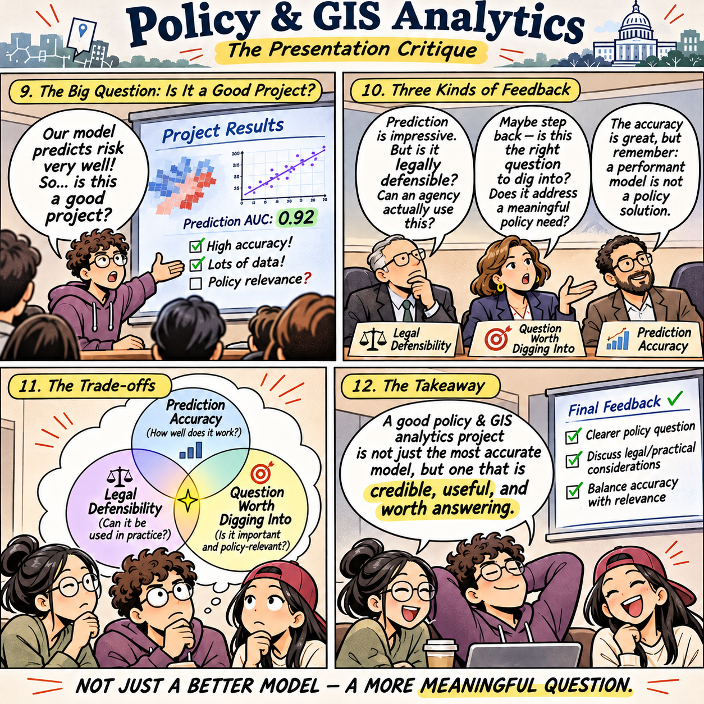

**Course Docket No. 001** 
**MUSA 4040 / CPLN 4180 Policy & GIS Analytics: *Advanced Solutions to Unidentified Problems*** 
*Course Introduction | Department of Problems Yet to Be Identified*

**Instructor:** Dr. Claude, PhD 
**Title:** Professor of City and Regional Planning, University of Unplanned 
**Email:** no-reply@claude.edu 
**Office Hours:** By appointment only. Appointments are subject to algorithmic approval.

Policy & GIS Analytics aims to develop students’ ability to evaluate the fairness, transparency, and societal implications of quantitative models. Particular attention is devoted to understanding how data-driven approaches can inform public decisions, especially when the underlying policy problem has not yet been clearly identified.

Throughout the course, students will gain hands-on experience constructing sophisticated analytical frameworks for urban problems, while delegating all decisions to AI bots. These problems may be hypothetical, statistically convenient, or independently invented for the purpose of completing an assignment.

Special emphasis is placed on reproducibility, compelling visualizations, and the successful rendering of Quarto documents through RStudio. Students will also learn to use GitHub as a sophisticated system for random version control, including adopting commit messages such as `~ 1` to ensure that collaborators remain entirely unaware of what has changed.

By the end of the course, students should be able to distinguish prediction from explanation and confidently present findings whose practical applications remain permanently outside the scope of consideration.

**Prerequisites:** Introduction to GIS, and a willingness to discover the research question after completing the analysis.

**Final Deliverable / Presentation:** Three distinguished sharks will be invited to critique each team's work: one from the School of Doing Nothing, one from the World of Predicting Everything, and one from the Department of Technical Obsessions. Each will evaluate the project according to different and mutually incompatible standards. Students should expect contradictory, occasionally unreasonable, and consistently authoritative feedback, which is designed to train them to transform a clear understanding of a problem into complete intellectual uncertainty.

The final report, accompanied by a Quarto website, is due at the end of the semester. Students are expected to struggle until the very last minute, preferably with an unexplained rendering error that did not exist the previous evening.

## Scenes from class

